# ÖlçekLab Kullanıcı Kılavuzu

**Sürüm:** 1.0 (Faz 5 yazılımı) · **Tarih:** 3 Kasım 2026
**Çevrim içi adres:** https://olceklab.netlify.app

ÖlçekLab, ölçek geliştirme ve uyarlama çalışmalarında gereken analizleri tek bir web arayüzünden, tekrarlanabilir biçimde yapmanızı sağlar. Bütün hesaplar arka planda R ile (lavaan, psych, semTools) yapılır; ekranda gördüğünüz her sayı R motorundan gelir. Her sonucu üreten R kodunu indirebilir, analizlerinizi başka bir bilgisayarda birebir yeniden üretebilirsiniz.

---

## İçindekiler

1. [Başlamadan önce](#1-başlamadan-önce)
2. [Genel düzen](#2-genel-düzen)
3. [Veri: yükleme, sütun rolleri ve temizleme](#3-veri)
4. [Madde analizi ve uygunluk](#4-madde-analizi-ve-uygunluk)
5. [Faktör sayısı: paralel analiz](#5-faktör-sayısı-paralel-analiz)
6. [Açımlayıcı faktör analizi (AFA)](#6-açımlayıcı-faktör-analizi-afa)
7. [Doğrulayıcı faktör analizi (DFA)](#7-doğrulayıcı-faktör-analizi-dfa)
8. [Güvenirlik ve geçerlik](#8-güvenirlik-ve-geçerlik)
9. [Ölçme değişmezliği](#9-ölçme-değişmezliği)
10. [Monte Carlo simülasyonu](#10-monte-carlo-simülasyonu)
11. [Rapor ve proje dosyası](#11-rapor-ve-proje-dosyası)
12. [Ayarlar](#12-ayarlar)
13. [Sık karşılaşılan durumlar](#13-sık-karşılaşılan-durumlar)

---

## 1. Başlamadan önce

### Veri dosyanız nasıl olmalı?

- **Biçim:** CSV (UTF-8) ya da Excel (XLSX). CSV'de ayraç noktalı virgül, virgül ya da sekme olabilir.
- **Düzen:** Her satır bir katılımcı, her sütun bir değişkendir. İlk satır sütun adlarını içerir.
- **Maddeler:** Sayısal olmalıdır (ör. 1–5 arası Likert yanıtları).
- **Grup değişkeni** (isteğe bağlı): Ölçme değişmezliği sınayacaksanız grupları gösteren bir sütun gerekir (ör. "Ortaokul", "Lise").
- **Kimlik bilgisi:** Ad, öğrenci numarası ya da T.C. kimlik numarası içeren sütunları dosyadan çıkarın. ÖlçekLab bu tür sütunları algılamaya çalışır, ama algılamanın her durumu yakalayacağı garanti edilemez.

### Gizlilik: çevrim içi mi, yerel mi?

| | Çevrim içi (olceklab.netlify.app) | Yerel kurulum (kendi bilgisayarınız) |
|---|---|---|
| Kurulum | Gerekmez | Docker ile bir kez kurulur (bkz. `docs/KURULUM_TR.md`) |
| Veri nereye gider? | R motoruna (Hugging Face sunucusu); diske yazılmaz, oturum belleğinde işlenir | Bilgisayarınızdan dışarı çıkmaz |
| Simülasyon sınırları | Tekrar × koşul ≤ 2000, en fazla 2 işçi, iş başına en fazla 1 saat | Sınır yok |
| Önerilen kullanım | Örnek veri, anonim veri, öğretim | **Öğrenci verisi gibi kişisel veriler (KVKK)** |

Yüklenen veriler hiçbir modda diske kalıcı olarak yazılmaz; oturum 60 dakika işlem yapılmazsa bellekten silinir.

---

## 2. Genel düzen

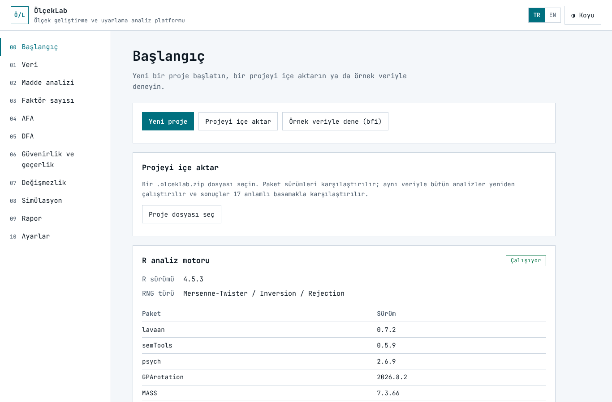

- **Sol menü:** Analizler sırayla numaralandırılmıştır (00 Başlangıç → 10 Ayarlar). Genellikle bu sırayla ilerlenir. Ancak temizleme yapıldıktan sonra istediğiniz sayfaya geçebilirsiniz.
- **Sağ üst köşe:** Dil seçimi (TR/EN) ve tema (açık/koyu).
- **Başlangıç sayfası:**
  - **Yeni proje** ile sıfırdan başlarsınız.
  - **Projeyi içe aktar** ile daha önce kaydettiğiniz bir `.olceklab.zip` dosyasını açarsınız.
  - **Örnek veriyle dene** ile platformu hazır bir veri setiyle tanıyabilirsiniz.
- **R analiz motoru kutusu:** Motorun durumunu ("Çalışıyor") ve kullanılan R ile paket sürümlerini gösterir. Bu sürümleri makalenizin yöntem bölümünde raporlayabilirsiniz.

**Her sonuç sayfasında üç düğme bulunur:**
- **Bu analizin R kodunu indir:** Sonucu baştan üreten, bağımsız çalışan R betiği.
- **Bu sonucu rapora ekle:** Sonuç Rapor sayfasındaki listeye eklenir.
- **CSV indir / SVG indir / PNG indir:** Tablo ve grafikleri dışa aktarır.

---

## 3. Veri

### 3.1 Dosya yükleme ve sütun rolleri

**Dosya seç (CSV ya da XLSX)** düğmesiyle dosyanızı yükleyin. Denemek için **Örnek: bfi (psych)** ya da **Örnek: HolzingerSwineford1939 (lavaan)** düğmelerini kullanabilirsiniz.

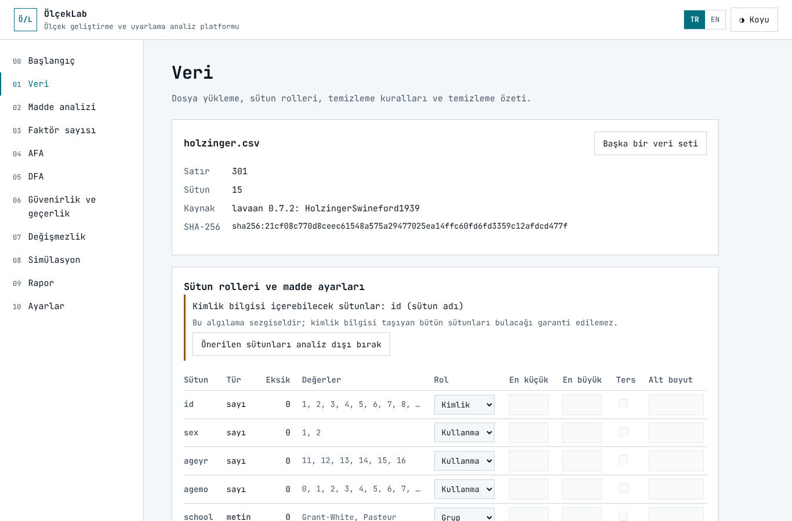

Yüklemeden sonra her sütun için bir **rol** seçin:

| Rol | Anlamı |
|---|---|
| Madde | Ölçek maddesi; analizlere girer |
| Grup | Grup değişkeni (ör. kademe, cinsiyet); değişmezlik için gerekir |
| Kimlik | Katılımcı kimliği; analize girmez |
| Kullanma | Analiz dışı |

Her madde için şu ayarlar yapılabilir:
- **En küçük / en büyük:** Geçerli yanıt aralığı (ör. 1–5).
- **Ters:** Ters puanlanan madde.
- **Alt boyut:** İsteğe bağlı alt boyut etiketi.

Grup sütunu seçtiyseniz **Geçerli grup değerleri** alanına geçerli değerleri virgülle yazın. Bu alanı boş bırakırsanız yalnızca grup değeri eksik olan satırlar geçersiz sayılır.

Ayarları bitirince **Rolleri kaydet** düğmesine basın.

> **İpucu:** Kimlik bilgisi içerebilecek sütunlar sarı bir uyarı kutusunda listelenir. **Önerilen sütunları analiz dışı bırak** seçeneğiyle hepsini tek seferde dışarıda bırakabilirsiniz.

### 3.2 Temizleme

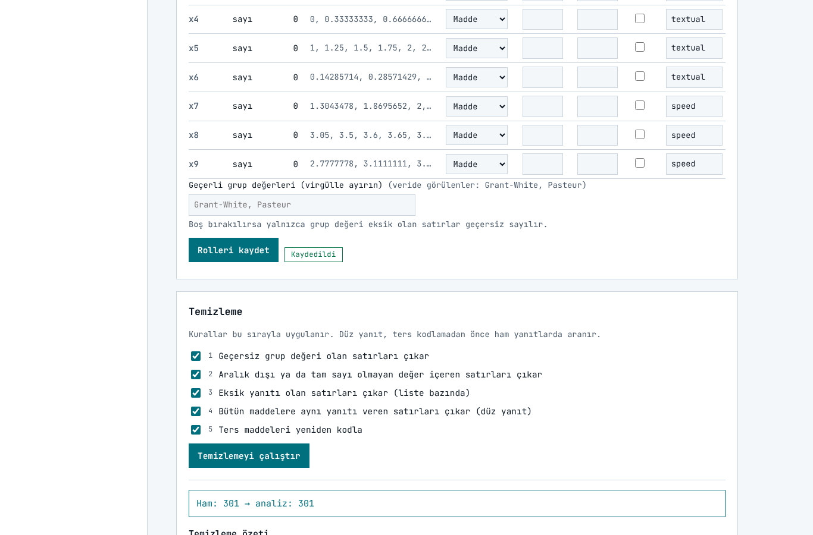

Kurallar ekranda görünen sırayla uygulanır. Her biri açılıp kapatılabilir:

1. Geçersiz grup değeri olan satırları çıkar
2. Aralık dışı ya da tam sayı olmayan değer içeren satırları çıkar
3. Eksik yanıtı olan satırları çıkar (liste bazında silme)
4. Bütün maddelere aynı yanıtı veren satırları çıkar (düz yanıt). Bu denetim, ters kodlamadan önce ham yanıtlarda yapılır.
5. Ters maddeleri yeniden kodla

**Temizlemeyi çalıştır** düğmesine bastığınızda, her adımda kaç satırın neden çıkarıldığını gösteren bir özet tablo üretilir. Bu tablo makalenizin "Çalışma Grubu" bölümü için doğrudan kullanılabilir.

> Temizleme çalıştırılmadan diğer analiz sayfaları açılmaz.

---

## 4. Madde analizi ve uygunluk

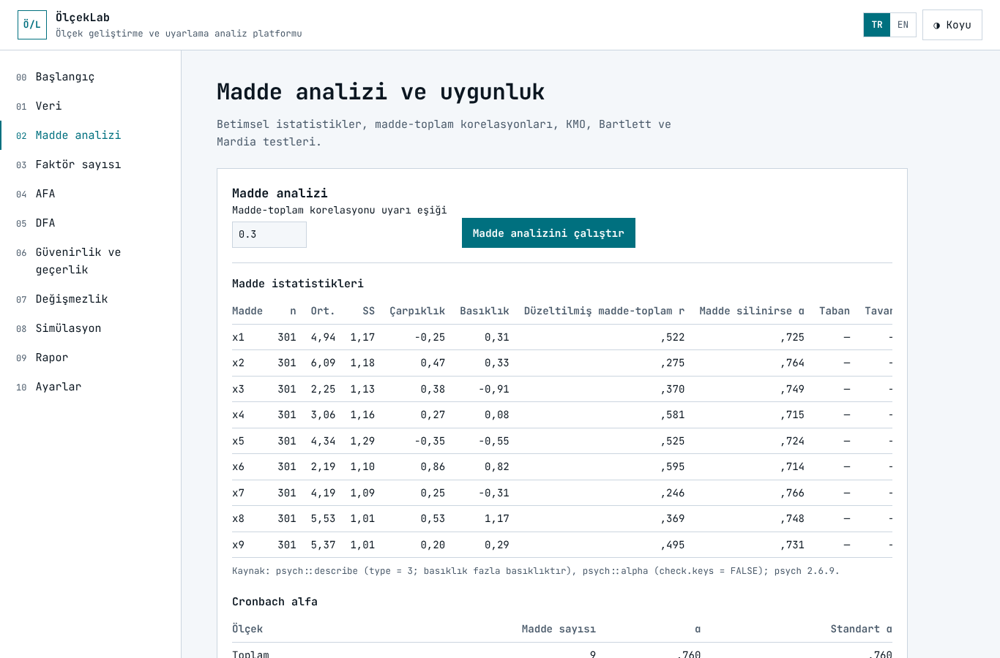

**Madde analizini çalıştır** her madde için şunları hesaplar:
- ortalama, standart sapma, çarpıklık, basıklık,
- düzeltilmiş madde-toplam korelasyonu,
- madde silinirse alfa,
- kategori dağılımı ısı haritası.

Madde-toplam korelasyonu belirlediğiniz eşiğin altında kalan, boş kategorisi olan ya da aşırı çarpık maddeler uyarı olarak listelenir.

**Uygunluk testlerini çalıştır** ile faktör analizine uygunluk sınanır:
- **KMO:** toplam ve madde bazında,
- **Bartlett küresellik testi,**
- **Mardia çok değişkenli normallik katsayıları.**

---

## 5. Faktör sayısı: paralel analiz

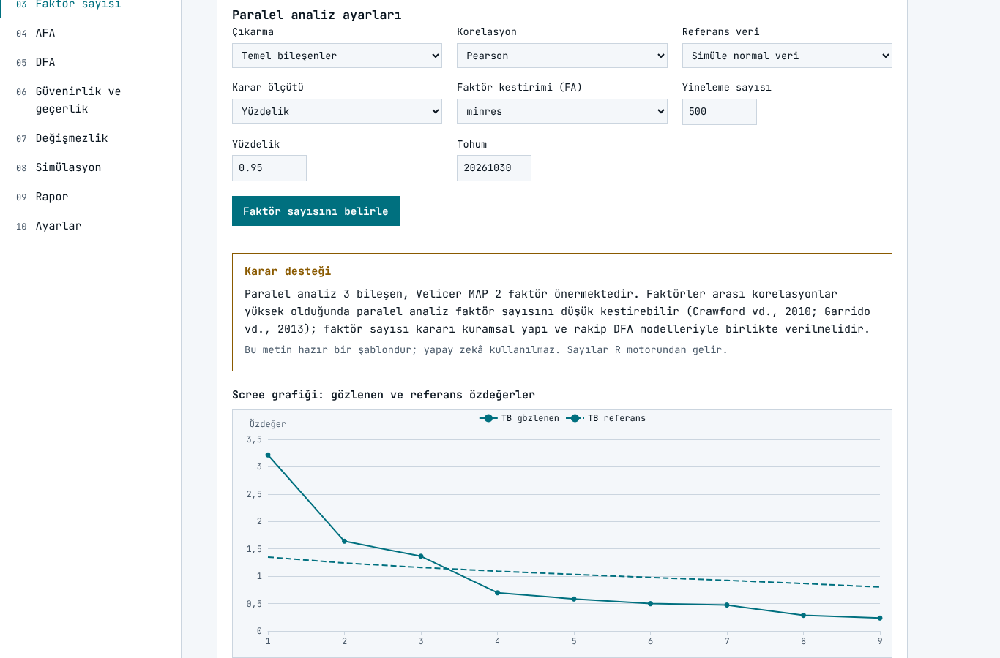

### Ayarlar

| Ayar | Seçenekler | Öneri |
|---|---|---|
| Çıkarma | Temel bileşenler, Ortak faktörler, İkisi de | Raporlarda en yaygın olanı temel bileşenlerdir |
| Korelasyon | Pearson, Polikorik | Az kategorili (≤ 5) maddelerde polikorik de denenebilir |
| Referans veri | Simüle normal veri; sütun içi yeniden örnekleme; sütun içi permütasyon | Varsayılan: simüle normal veri |
| Karar ölçütü | Yüzdelik (ör. 0.95) ya da ortalama | %95'lik yaygın kullanılan ölçüttür |
| Yineleme sayısı | ör. 1000 | Raporlanacak analizde en az 1000 |
| Tohum | ör. 20261030 | Aynı tohum aynı sonucu verir |

**Faktör sayısını belirle** düğmesine bastığınızda şunlar üretilir:
- gözlenen ve referans özdeğer tablosu,
- scree grafiği,
- Velicer MAP testi sonucu,
- **Karar desteği** kutusu.

### Karar desteğini nasıl okumalı?

Karar desteği kutusundaki metin hazır bir şablondur ve yapay zekâ kullanmaz. Paralel analiz ile MAP'in önerdiği sayıları birlikte verir. Ayrıca faktörler arasındaki korelasyonlar yüksek olduğunda paralel analizin faktör sayısını düşük kestirebileceğini hatırlatır.

Bu uyarının önemli bir pratik sonucu var. Kuramsal olarak dört faktörlü bir ölçekte paralel analizin iki faktör önermesi yapıyla her zaman çelişmez. Bu durumda karar, rakip modellerin DFA ile karşılaştırılmasıyla verilmelidir (bkz. Bölüm 7). Kendi ölçeğinizde paralel analizin ne kadar güvenilir olduğunu Simülasyon sayfasında sınayabilirsiniz (bkz. Bölüm 10).

---

## 6. Açımlayıcı faktör analizi (AFA)

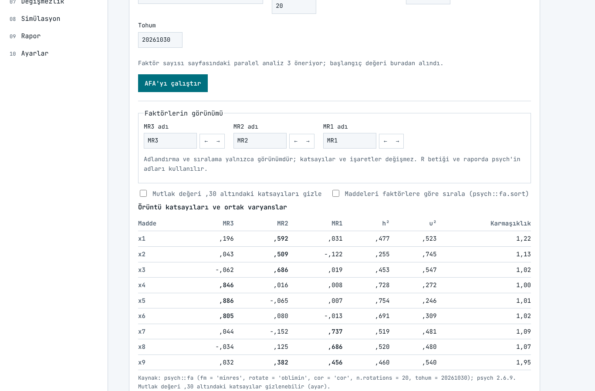

Faktör sayısı, paralel analizin önerisiyle otomatik doldurulur; isterseniz değiştirebilirsiniz.

**Ayarlar:**
- **Kestirim yöntemi:** minres, ml, pa, uls.
- **Döndürme:**
  - eğik: oblimin, promax, geominQ;
  - dik: varimax;
  - ya da döndürme yok.
- **Korelasyon:** Pearson ya da polikorik.
- **Yük gösterim eşiği:** ör. .30.

> Polikorik korelasyonla `ml` önerilmez; bu durumda ekranda uyarı çıkar. minres ya da uls kullanın.

**Çıktılar:**
- örüntü katsayıları,
- ortak varyanslar,
- faktörler arası korelasyonlar,
- açıklanan varyans,
- çapraz yük ve Heywood uyarıları.

**Faktörlerin görünümü** bölümünde faktörleri yeniden adlandırabilir ve sıralayabilirsiniz. Bu yalnızca görünümü değiştirir; katsayılar değişmez.

---

## 7. Doğrulayıcı faktör analizi (DFA)

### 7.1 Model kurucu

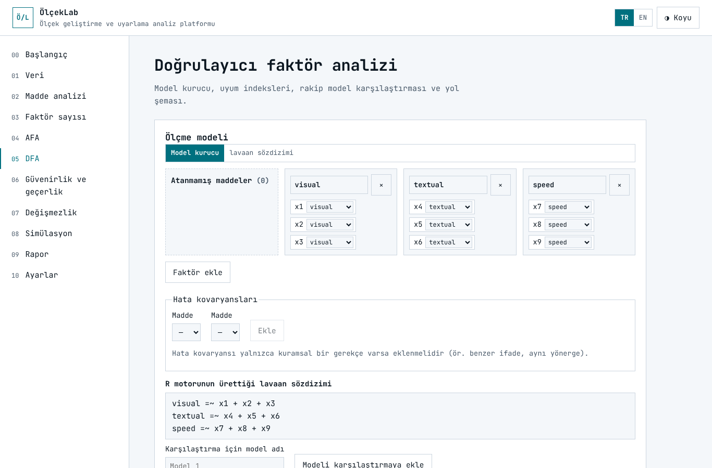

Maddeleri faktörlere atayarak modeli kurun. Kurduğunuz model otomatik olarak lavaan sözdizimine çevrilir. Deneyimli kullanıcılar **lavaan sözdizimi** sekmesinden modeli doğrudan yazabilir; hata kovaryansları da buradan eklenebilir.

**Ayarlar:**

| Ayar | Seçenekler | Not |
|---|---|---|
| Kestirici | ML, MLR, WLSMV | Likert maddeleri sıralı veri olarak ele almak için WLSMV |
| Olabilirlik | normal (N), **Wishart (N − 1)** | Wishart, AMOS/LISREL ile aynı χ²'yi verir |
| std.lv | Faktör varyanslarını 1'e sabitle | |
| Bollen–Stine bootstrap | Bootstrap sayısı B | Yalnızca ML, sürekli kabul edilen ve eksiksiz veride kullanılabilir. Uzun sürebilir |

### 7.2 Sonuçlar ve yol şeması

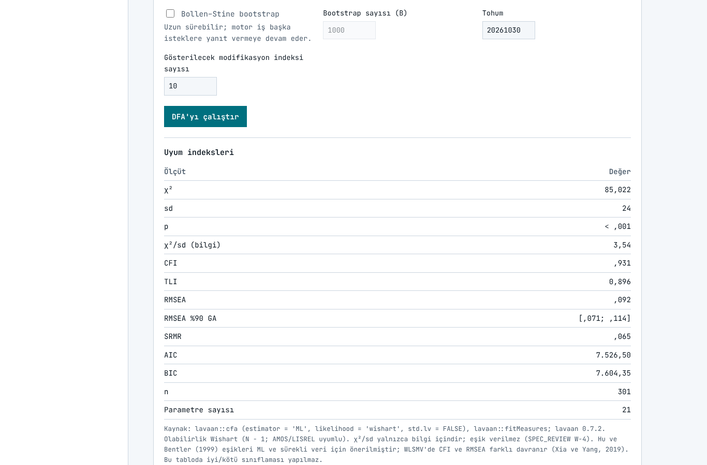

**Çıktılar:**
- uyum indeksleri: χ², sd, χ²/sd, CFI, TLI, RMSEA ve %90 güven aralığı, SRMR (WLSMV'de ölçeklenmiş ve dayanıklı değerler ayrı etiketlenir),
- standardize yükler,
- faktör korelasyonları,
- uygunsuz çözüm denetimi,
- modifikasyon indeksleri.

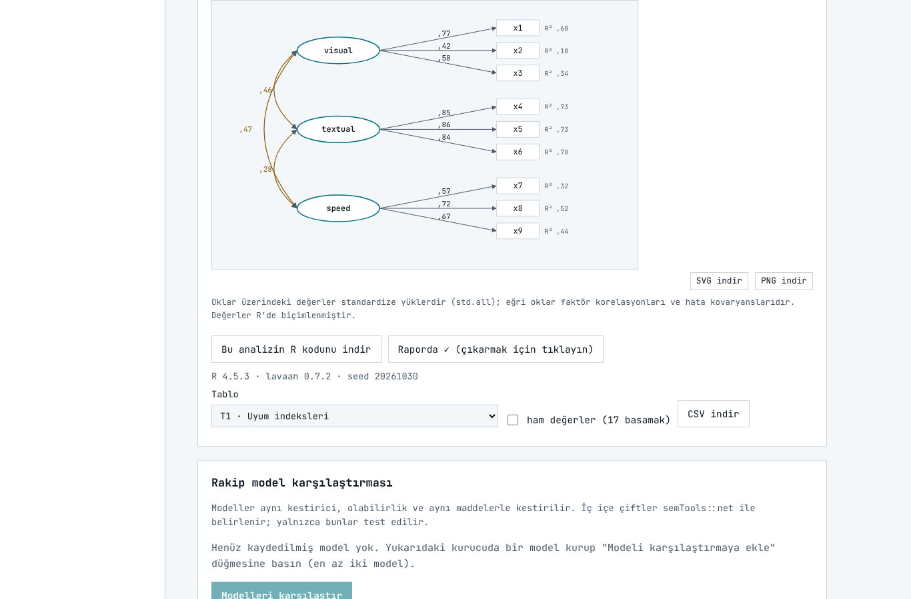

Yol şeması standardize çözümü gösterir ve SVG ya da PNG olarak indirilebilir.

### 7.3 Rakip modelleri karşılaştırma

1. Bir model kurun, **Karşılaştırma için model adı** alanına ad verin ve **Modeli karşılaştırmaya ekle** düğmesine basın.
2. Aynı işlemi diğer modeller için tekrarlayın (en az iki model).
3. **Modelleri karşılaştır** düğmesine basın.

İç içe modeller otomatik belirlenir ve ölçeklenmiş χ² fark testiyle karşılaştırılır. Bütün modeller için AIC/BIC de verilir.

> Modifikasyon indekslerine bakarak hata kovaryansı eklemek, kuramsal gerekçe olmadan önerilmez.

---

## 8. Güvenirlik ve geçerlik

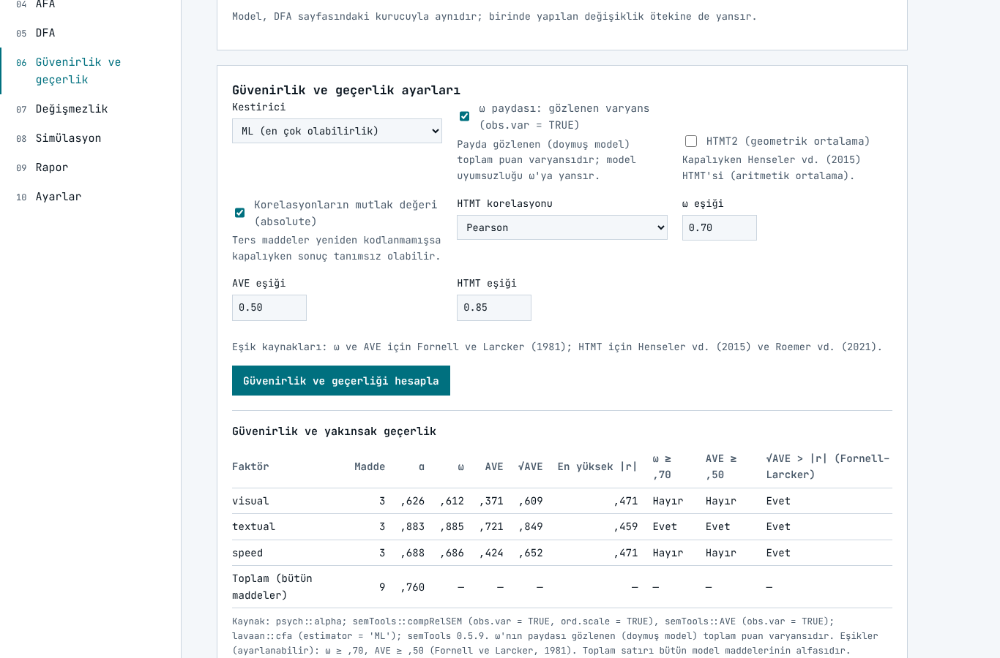

Ölçme modeli DFA sayfasıyla ortaktır; birinde yapılan değişiklik ötekine de yansır.

**Hesaplananlar:**
- Cronbach alfa,
- ω/CR,
- AVE,
- HTMT.

**Seçenekler:**
- **ω paydası (obs.var):**
  - Açık: payda, gözlenen toplam puan varyansıdır; model uyumsuzluğu ω'ya yansır.
  - Kapalı: payda, modelin örtük varyansıdır; hata kovaryansı yoksa McDonald ω'sına (CR) eşittir.
- **HTMT2:** Kapalıyken Henseler vd. (2015) HTMT'si (aritmetik ortalama) hesaplanır.
- **Mutlak değer (absolute):** Korelasyonların mutlak değeri kullanılır. Ters maddeler yeniden kodlanmamışsa kapalı hâlde sonuç tanımsız olabilir.
- **Eşikler:** ω, AVE ve HTMT eşikleri ayarlanabilir; tabloda eşiğe göre işaretleme yapılır.

---

## 9. Ölçme değişmezliği

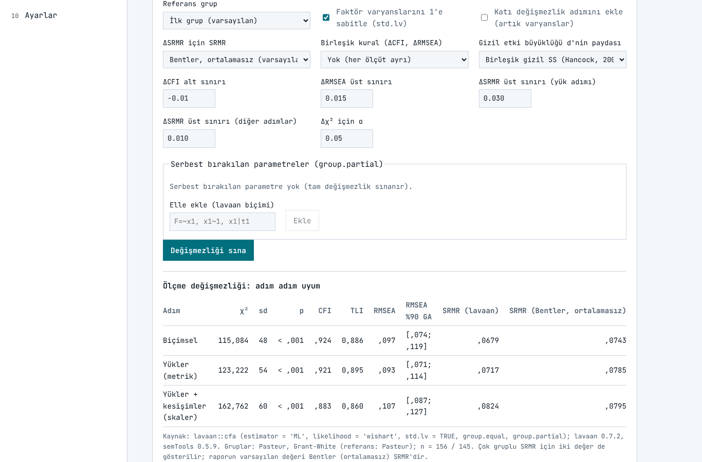

Bu sayfa için Veri sayfasında bir sütunu **Grup** olarak işaretlemiş olmanız gerekir.

**Ayarlar:**
- **Yaklaşım:**
  - Sürekli (ML/MLR),
  - Kategorik (WLSMV, theta parametrizasyonu, Wu–Estabrook tanımlaması).
- **Referans grup** ve isteğe bağlı **katı değişmezlik** adımı.
- **Karar ölçütleri:**
  - ΔCFI alt sınırı (varsayılan −,01),
  - ΔRMSEA üst sınırı (varsayılan ,015),
  - ΔSRMR,
  - Δχ² için α.
  - **Birleşik kural:** ΔCFI ve ΔRMSEA'nın birlikte mi, ayrı ayrı mı değerlendirileceği.
- **SRMR türü:** Varsayılan, ortalama yapısını dışarıda bırakan Bentler SRMR'dir. Bu değer tek gruplu modellerle karşılaştırılabilir.

**Değişmezliği sına** düğmesi adım adım (biçimsel → metrik → skaler → [katı]) sonuçları ve her ölçütün kararını ayrı sütunlarda gösterir.

### Kısmi değişmezlik sihirbazı

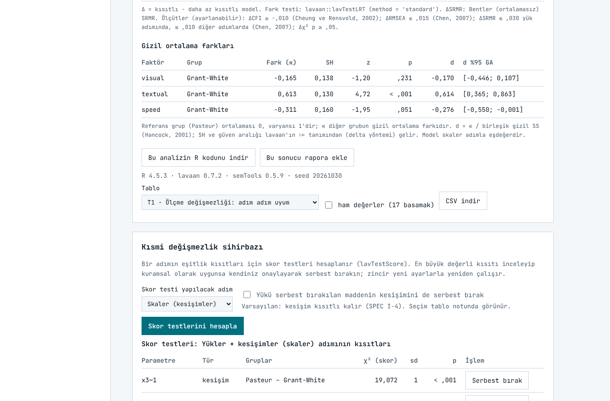

Bir adımda Δχ² anlamlı çıkarsa farkın hangi maddeden kaynaklandığını bulmak için:

1. **Skor testi yapılacak adım** kutusundan adımı seçin (ör. Skaler) ve **Skor testlerini hesapla** düğmesine basın.
2. Tablo, eşitlik kısıtlarını skor testi değerine göre sıralar.
3. En büyük değerli kısıtı inceleyin. Kuramsal olarak uygunsa **Serbest bırak** düğmesine basıp onaylayın; zincir yeni ayarlarla yeniden çalışır.
4. Δχ² anlamsız hâle gelene kadar adımları tekrarlayın.

> Veri güdümlü serbest bırakmalar bağımsız bir örneklemde doğrulanmalıdır (Byrne vd., 1989). Bu nedenle sihirbaz hiçbir kısıtı kendiliğinden serbest bırakmaz; her adım sizin onayınızla yapılır.

**Gizil ortalamalar:** Değişmezlik sağlandığında referans grubun gizil ortalaması 0 alınır. Diğer grupların farkı, standart hatası, z ve p değerleri ile d etki büyüklüğü verilir. Gizil ortalamaların hesaplanabilmesi için her faktörde yükü ve kesişimi değişmez kalan en az iki madde bulunmalıdır.

---

## 10. Monte Carlo simülasyonu

Simülasyon sayfası, kendi ölçek yapınız için örneklem büyüklüğü, güç ve yöntemlerin davranışı hakkında bilgi verir (Muthén ve Muthén, 2002).

> **Önemli:** Simülasyon sonuçları sentetik verilere dayanır ve **ölçeğin geçerliğine kanıt değildir**. Bu uyarı bütün simülasyon ekranlarında ve raporlarda sabit olarak görünür.

### 10.1 Kurulum

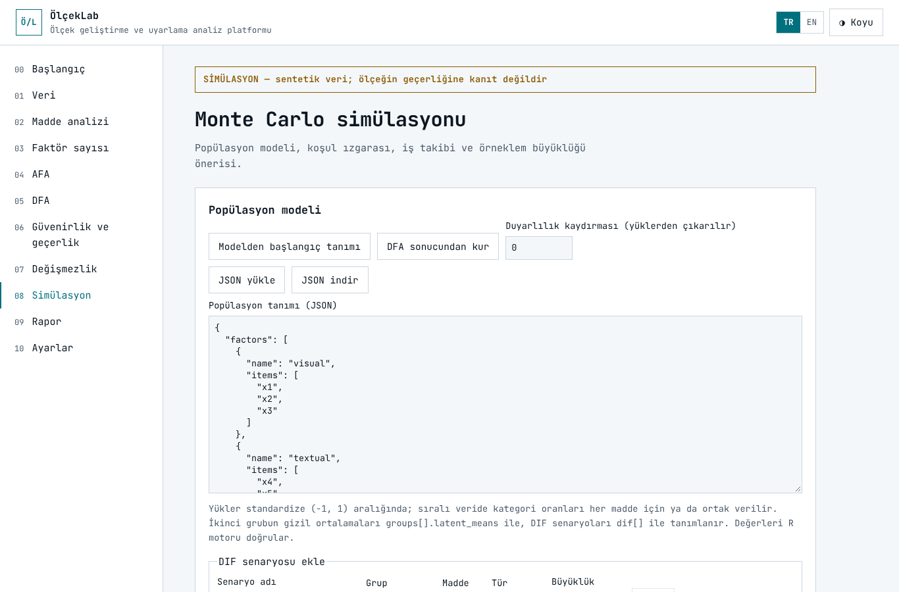

1. **Popülasyon modeli:** Popülasyon modelini şu yollardan biriyle tanımlayın:
   - **DFA sonucundan kur** (önerilir): DFA sayfasında kestirdiğiniz modelin özet parametreleri alınır. Ham verileriniz simülasyona aktarılmaz.
   - JSON tanımını elle düzenleyin.
   - **JSON yükle** ile daha önce kaydettiğiniz bir tanımı açın.
2. **DIF senaryosu ekle:** Seçtiğiniz grupta seçtiğiniz maddeye farklılık ekleyin:
   - eşik ya da kesişim kayması,
   - yük farkı.

   Kontrol (değişmez) senaryosu her zaman ilk koşul olarak çalışır.
3. **Koşullar:**
   - toplam N listesi (ör. `300, 600, 1000`),
   - grup oranları (ör. `50/50`),
   - tekrar sayısı,
   - parça büyüklüğü,
   - kestiriciler,
   - her tekrarda yapılacak analizler: DFA, değişmezlik, güvenirlik, paralel analiz.
4. **Süreyi tahmin et** düğmesi birkaç tekrar çalıştırıp toplam süreyi tahmin eder. Büyük işlere başlamadan önce mutlaka kullanın.
5. **Simülasyonu başlat** ile işi başlatın.
   - İş arka planda parça parça çalışır. İlerleme çubuğu, geçen süre ve kalan süre tahmini görünür.
   - **İptal et** ile durdurulan iş, **Sürdür** ile kaldığı yerden devam eder.

### 10.2 Sonuçlar

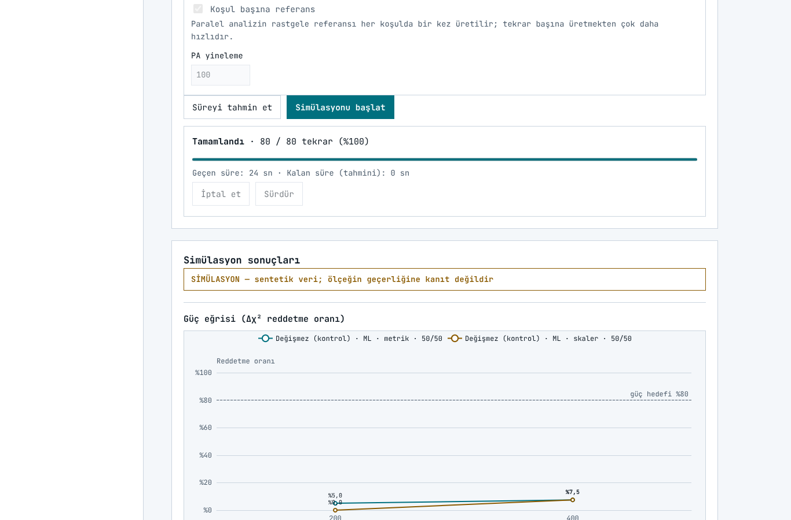

**Çıktılar:**
- **Güç eğrisi:** N'ye göre Δχ² reddetme oranı. Kontrol senaryosunda bu oran I. tip hatadır, DIF senaryolarında güçtür.
- **Göreli yanlılık ısı haritası.**
- **Yakınsama ve uygun çözüm oranları.**
- **Örneklem büyüklüğü önerisi:** Seçilen ölçütlerin hepsini sağlayan en küçük N.

### 10.3 Çevrim içi sınırlar ve bağımsız paket

Çevrim içi sürümde tekrar × koşul en fazla 2000, iş başına süre en fazla 1 saattir. Daha büyük simülasyonlar için **Bağımsız R paketini indir (.zip)** düğmesini kullanın. Paket, simülasyonu kendi bilgisayarınızda ya da güçlü bir hesaplama ortamında (ör. EVREN) çalıştırmanız için gereken her şeyi içerir. Sabit tohum sayesinde sonuçlar birebir aynı çıkar.

---

## 11. Rapor ve proje dosyası

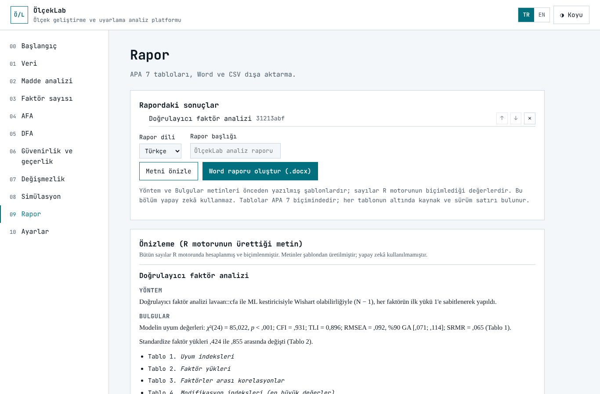

**Rapor sayfası:**
- Analiz sayfalarında **Bu sonucu rapora ekle** düğmesiyle eklediğiniz sonuçlar burada listelenir. Sıralarını değiştirebilir ya da rapordan çıkarabilirsiniz.
- **Rapor dili** (Türkçe/İngilizce) ve **rapor başlığı** seçilir.
- **Metni önizle:** Yöntem ve Bulgular taslak metnini gösterir. Bu metinler önceden yazılmış şablonlardır ve yapay zekâ kullanmaz; sayılar R motorunun biçimlediği değerlerdir.
- **Word raporu oluştur (.docx):** APA 7 biçiminde tablolar üretir; her tablonun altında kaynak ve sürüm satırı bulunur.

**Proje dosyası (.olceklab.zip)** şunları içerir:
- ayarlar,
- sonuç kayıtları (17 anlamlı basamak),
- R betikleri,
- sürüm bilgisi,
- verinin SHA-256 özeti.

Veri dosyası varsayılan olarak projeye **eklenmez**. Eklemek isterseniz KVKK onay kutusunu işaretlemeniz gerekir.

Projeyi daha sonra **Başlangıç → Projeyi içe aktar** ile açtığınızda bütün analizler aynı veriyle yeniden çalıştırılır ve sonuçlar karşılaştırılır. "Bütün sonuçlar 17 anlamlı basamakta aynı" iletisi, analizinizin birebir tekrarlanabildiğini gösterir.

---

## 12. Ayarlar

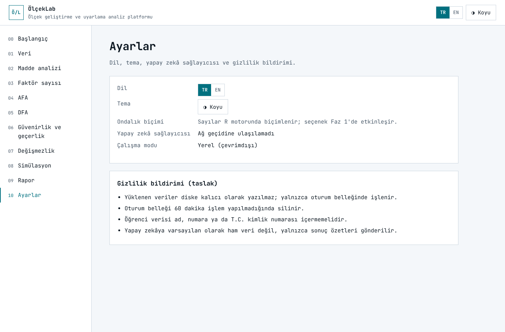

Bu sayfada şunlar bulunur:
- dil ve tema,
- çalışma modu (yerel ya da çevrim içi),
- gizlilik bildirimi,
- yapay zekâ sağlayıcısının durumu.

### 12.1 Yapay zekâ yorum asistanı

Canlı sitede analiz sonucunun altında **Yapay zekâ ile yorumla** düğmesi bulunur. Düğmeye bastığınızda EVREN üzerinden yorum oluşturulur.

1. Önce analizi çalıştırın. Sonuç kartındaki **Yapay zekâ ile yorumla** düğmesine basın. Bu düğme yalnızca yapılandırılmış ve çalışan bir yapay zekâ sağlayıcısı varsa görünür.
2. Ağ geçidine yalnızca biçimli toplu sonuç tabloları gönderilir. Modele sayısal değerler veya ham veri gönderilmez; model sonuç anahtarlarıyla bir metin üretir. R'nin biçimlediği değerler bu anahtarların yerine yerleştirilir. Model değerleri görmediği için istatistiksel kararın yerini alamaz.
3. Yanıt **Yapay zekâ yorumu — doğrulayınız** etiketiyle gösterilir. Yanlış ya da bilinmeyen sonuç anahtarları ve modelin kendisinin yazdığı sayılar kırmızı işaretlenir. Uyarılı metin rapora eklenemez. Denetim temkinlidir: metin içindeki sayı sözcükleri de işaretlenebilir.
4. Denetim başarılı olsa bile yorumu okuyup değerlendirin. **Rapora ekle (onaylıyorum)** düğmesine basmadan yorum rapora girmez. Bu işlem ilgili analiz sonucunu da rapora ekler.
5. Rapor sayfasında **Yapay zekâ yorumunu kaldır** ile yorumu çıkarabilirsiniz. Onaylı yorumlar önizleme ve Word dosyasında etiketleriyle görünür. Rapor kullanılan sağlayıcı ve modeli belirtir. Yorum eklenmezse yapay zekâ kullanılmadığı beyanı korunur.

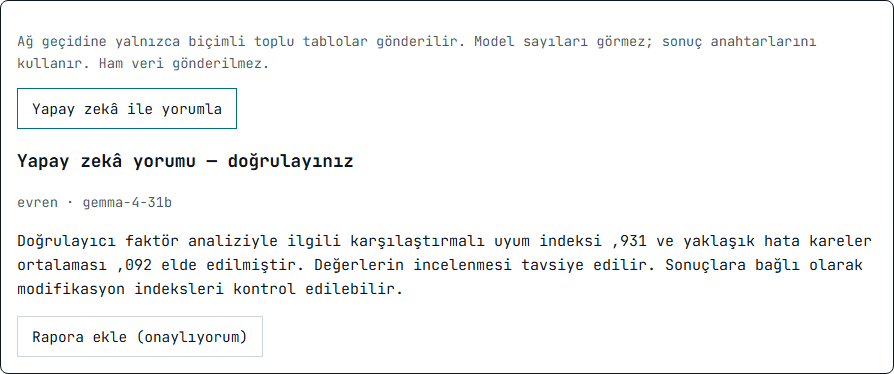

### 12.2 Oturum günlüğü

**Ayarlar → Yapay zekâ oturum günlüğü** bölümünden JSON veya Markdown indirin. Günlük; istemi, modelin yanıtını, doldurulmuş metni, sağlayıcı/model adını, zamanı ve sayı denetiminin sonucunu içerir. Ham veri, IP ve API anahtarı içermez.

Günlük ve onaylar yalnızca açık sekmenin belleğinde tutulur. Sayfayı yenilemeden veya kapatmadan önce günlüğü indirin. **Günlüğü temizle** kayıtları bu oturumdan siler; daha önce indirdiğiniz dosyaları silmez. Yapay zekâ günlüğü proje ZIP'ine otomatik eklenmez.

---

## 13. Sık karşılaşılan durumlar

| Durum | Neden ve çözüm |
|---|---|
| Başlangıç sayfasında motor "Bağlantı kurulamadı" diyor | Çevrim içi motor bir süre kullanılmadığında Hugging Face'te uyku moduna geçer. Birkaç dakika bekleyip **Yeniden dene** düğmesine basın; ilk açılış birkaç dakika sürebilir. |
| Analiz sayfası açılmıyor, "önce temizleme" uyarısı çıkıyor | Veri sayfasında **Rolleri kaydet** ve **Temizlemeyi çalıştır** adımlarını tamamlayın. |
| Türkçe karakterler bozuk görünüyor | CSV dosyasını UTF-8 olarak kaydedin ya da XLSX kullanın. |
| Değişmezlik sayfası kilitli | Veri sayfasında bir sütunu **Grup** olarak işaretleyip temizlemeyi yeniden çalıştırın. |
| Gizil ortalamalar kilitli | Bazı faktörlerde değişmez kalan madde sayısı ikinin altında; serbest bırakılan parametreleri gözden geçirin. |
| Bollen–Stine seçeneği kapalı | Yalnızca ML kestiricisiyle ve eksiksiz veride kullanılabilir. |
| Simülasyon "süre sınırı aşıldı" diyor | Çevrim içi sınırı aşıldı. Tekrar ya da koşul sayısını azaltın ya da bağımsız R paketini indirip yerelde çalıştırın. |
| Oturum kayboldu | Oturum 60 dakika işlem yapılmazsa silinir. Uzun çalışmalarda düzenli olarak proje dosyasını dışa aktarın. |

---

## Yöntemsel kaynaklar

- Byrne, B. M., Shavelson, R. J., & Muthén, B. (1989). Testing for the equivalence of factor covariance and mean structures: The issue of partial measurement invariance. *Psychological Bulletin, 105*(3), 456–466.
- Chen, F. F. (2007). Sensitivity of goodness of fit indexes to lack of measurement invariance. *Structural Equation Modeling, 14*(3), 464–504.
- Cheung, G. W., & Rensvold, R. B. (2002). Evaluating goodness-of-fit indexes for testing measurement invariance. *Structural Equation Modeling, 9*(2), 233–255.
- Henseler, J., Ringle, C. M., & Sarstedt, M. (2015). A new criterion for assessing discriminant validity in variance-based structural equation modeling. *Journal of the Academy of Marketing Science, 43*(1), 115–135.
- Horn, J. L. (1965). A rationale and test for the number of factors in factor analysis. *Psychometrika, 30*(2), 179–185.
- Muthén, L. K., & Muthén, B. O. (2002). How to use a Monte Carlo study to decide on sample size and determine power. *Structural Equation Modeling, 9*(4), 599–620.
- Rosseel, Y. (2012). lavaan: An R package for structural equation modeling. *Journal of Statistical Software, 48*(2), 1–36.
- Wu, H., & Estabrook, R. (2016). Identification of confirmatory factor analysis models of different levels of invariance for ordered categorical outcomes. *Psychometrika, 81*(4), 1014–1045.

Platformun yöntem ayrıntıları için `docs/METHODS_TR.md`, doğrulama kayıtları için `docs/VALIDATION.md` dosyalarına bakınız.
